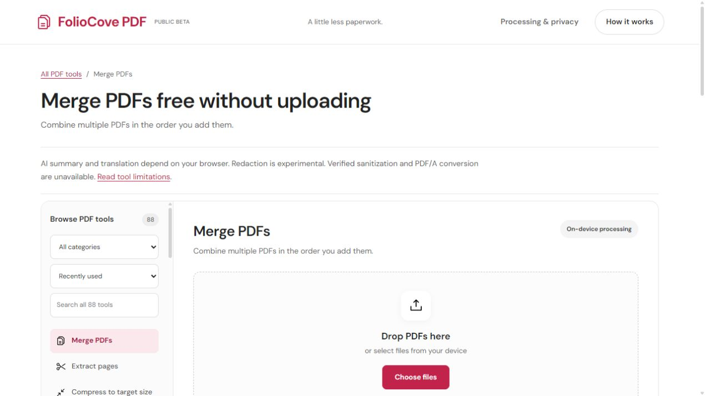

# FolioCove PDF — Free, open-source PDF tools

**Merge, split, compress and convert PDFs in your browser. Your documents are processed on your device, with no account or document uploads.**

[Open FolioCove PDF](https://mehbul.github.io/FolioCove/) · [Watch the merge demo](https://mehbul.github.io/FolioCove/demo/) · [Watch page extraction](https://mehbul.github.io/FolioCove/demo/extract-pdf/) · [Choose a PDF converter](https://mehbul.github.io/FolioCove/pdf-converter/) · [Browse tools and limits](https://mehbul.github.io/FolioCove/tools/) · [Get help](https://mehbul.github.io/FolioCove/support/)

[](https://mehbul.github.io/FolioCove/merge-pdf/)

FolioCove PDF is a free, MIT-licensed browser PDF workspace for everyday document tasks. Use it to combine PDFs, extract selected pages, rearrange pages, convert images to PDF or add text and visual signatures. No installation is needed to use the hosted app. Developers can build and host the static app themselves.

**Public beta:** keep originals and inspect outputs. Redaction is experimental, AI depends on browser support, and verified sanitization and PDF/A conversion are unavailable. Physical phone cameras, native downloads and actual Safari remain unverified. The 88-entry catalog includes experimental, conditional and unavailable tools; it is not a count of equally validated features.

[Try one five-minute task with synthetic samples](https://mehbul.github.io/FolioCove/try/) and share optional feedback by email. Merge and extraction workspaces can load their sample PDFs directly; no app account or personal document is needed.

## Try a PDF task now

| Task | Open the tool | What to expect |
| --- | --- | --- |
| Merge PDF files | [Merge PDFs](https://mehbul.github.io/FolioCove/merge-pdf/) | Combine PDFs in your chosen file order; merging does not verify signatures. |
| Split a PDF or extract pages | [Extract pages](https://mehbul.github.io/FolioCove/split-pdf/) | One new PDF containing your selected pages or ranges, not a separate file for every page. |
| Organize PDF pages | [Organize pages](https://mehbul.github.io/FolioCove/organize-pdf/) | Preview, rearrange or remove pages; inspect forms and annotations afterwards. |
| Compress PDF without rasterizing text | [Lossless compression](https://mehbul.github.io/FolioCove/lossless-compress-pdf/) | Optimize PDF structure; the file may not shrink and can become larger. |
| Compress PDF to a target size | [Target-size compression](https://mehbul.github.io/FolioCove/compress-pdf/) | Best-effort raster compression; loses selectable text, forms and accessibility information. |
| Convert JPG or PNG to PDF | [Images to PDF](https://mehbul.github.io/FolioCove/jpg-to-pdf/) | One image per page, ordered by you; no automatic A4 margins or OCR. |
| Convert PDF to JPG | [PDF to JPG](https://mehbul.github.io/FolioCove/pdf-to-jpg/) | A ZIP containing one rendered JPG per page, not original embedded-image extraction. |
| Convert PDF to Word | [PDF to DOCX](https://mehbul.github.io/FolioCove/pdf-to-word/) | Editable selectable text; original layouts, images and tables are not preserved. |
| Convert Word to PDF | [DOCX text to PDF](https://mehbul.github.io/FolioCove/word-to-pdf/) | Text-oriented conversion; legacy DOC, original formatting, images and tables are unsupported. |
| Convert PDF to Excel | [PDF to XLSX](https://mehbul.github.io/FolioCove/pdf-to-excel/) | One sheet per PDF page with approximate text rows; original tables and formulas are not recovered. |
| Convert Excel to PDF | [XLSX/XLS values to PDF](https://mehbul.github.io/FolioCove/excel-to-pdf/) | Text-oriented spreadsheet export; charts, styling and formula layout are not preserved. |
| Convert PDF to PowerPoint | [PDF to PPTX](https://mehbul.github.io/FolioCove/pdf-to-powerpoint/) | One PDF page as an image per slide; original text and graphics are not editable slide objects. |
| Convert PowerPoint to PDF | [PPTX slide text to PDF](https://mehbul.github.io/FolioCove/powerpoint-to-pdf/) | One text-oriented PDF page per slide; original graphics, design and legacy PPT are unsupported. |
| Add text to a PDF | [Edit PDF](https://mehbul.github.io/FolioCove/edit-pdf/) | Add a text overlay; does not rewrite existing paragraphs. |
| Add a signature to a PDF | [Sign PDF](https://mehbul.github.io/FolioCove/sign-pdf/) | A visible typed signature mark, not certificate signing or identity verification. |
| Make scanned text searchable | [English OCR](https://mehbul.github.io/FolioCove/ocr-pdf/) | Local recognition with an English model download; review words and numbers for errors. |

## How to merge PDFs without uploading

1. Open [Merge PDFs](https://mehbul.github.io/FolioCove/merge-pdf/).
2. Select at least two PDFs. Use Move up and Move down to set their order.
3. Choose **Merge & download**, then open the result and check its page count and order.

Want to try it before choosing your own files? The [worked merge example](https://mehbul.github.io/FolioCove/guides/merge-pdfs-without-uploading/) includes synthetic inputs, expected page labels and a reference PDF. The [extraction guide](https://mehbul.github.io/FolioCove/guides/extract-pages-from-pdf/) provides a six-page sample and a pages 2–4 reference.

Prepared downloads show their actual size and a Download again link. The browser does not overwrite your original files. Large, malformed or password-protected inputs can fail; the beta limit is 100 MB per file and practical device limits may be lower.

For an unlocked PDF result within the beta file limit, choose **Next PDF tool** and **Use this PDF** to continue into page organization, page extraction or lossless compression without selecting the downloaded file again. The prepared PDF stays in memory on your device; the next tool opens with fresh settings and waits for you to review its limits and run it. ZIP, Office-document and password-protected results keep their ordinary download controls.

## Why use a browser PDF tool with on-device processing?

- **No document-upload endpoint:** selected files are processed on your device rather than sent to a FolioCove processing server.
- **No account required:** open a task, select files and download the result.
- **Inspectable source:** the [MIT license](LICENSE), [processing model](https://mehbul.github.io/FolioCove/security/) and [capability catalog](https://mehbul.github.io/FolioCove/capabilities.json) are public.
- **Examples you can reproduce:** check synthetic page labels and reference outputs yourself.
- **Limits before processing:** conversion fidelity, raster compression and browser requirements are disclosed.

On-device processing does not mean zero network traffic or guaranteed security. The host serves site assets; OCR and browser AI may download models. Read the [privacy explanation](https://mehbul.github.io/FolioCove/privacy/) and [tool limitations](https://mehbul.github.io/FolioCove/limitations/).

## Looking for an iLovePDF or Smallpdf alternative?

FolioCove is an option for everyday browser PDF tasks when you want on-device document processing and open-source code. It does not replace every workflow offered by iLovePDF, Smallpdf, Adobe Acrobat or PDF24.

Read the publisher-disclosed [iLovePDF alternative comparison](https://mehbul.github.io/FolioCove/blog/ilovepdf-alternative/) and [Smallpdf alternative comparison](https://mehbul.github.io/FolioCove/blog/smallpdf-alternative/). Each article identifies its source-check date, links official provider information and explains FolioCove's limitations. Pricing, features and processing methods vary by product and can change. These are independent brands; no affiliation or endorsement is implied.

Choose a different, suitably validated workflow if you need high-fidelity Office reconstruction, verified sanitization, validated PDF/A, certificate-based signatures or remote signature requests.

## Frequently asked questions

### Is FolioCove PDF free and open source?

Yes. The public beta is free to use without an app account. The source is MIT licensed; dependencies retain their own licenses. FolioCove PDF is also written FolioCovePDF; the established repository name and URL remain FolioCove.

### Can I merge PDFs online without uploading them?

Yes. FolioCove's website loads in your browser, but the merge operation processes selected files on your device. Try the [merge workspace](https://mehbul.github.io/FolioCove/merge-pdf/) with synthetic samples first. Ordinary site requests still reach the host.

### Can I use FolioCove offline?

Do not rely on full offline operation. Site assets must be available and some tools need model downloads or supported browser APIs. On-device processing and offline availability are different requirements.

### Can I convert a PDF to an editable Word document?

The [PDF to DOCX tool](https://mehbul.github.io/FolioCove/pdf-to-word/) exports selectable text into a genuine Word document. It does not reconstruct original layouts, images or tables. Scanned documents need OCR first.

### Which PDF compression should I use?

Try [lossless compression](https://mehbul.github.io/FolioCove/lossless-compress-pdf/) when selectable text and page content matter. Target-size compression rasterizes pages and can lose text selection, forms and accessibility information. Neither method guarantees a particular size. See the [compression guide](https://mehbul.github.io/FolioCove/guides/reduce-pdf-size/).

### Does FolioCove work on phones and Safari?

Engine and emulation checks cover a limited scope. Physical camera capture, native phone downloads and Apple's Safari app have not completed real-device validation. Test your actual device before relying on a workflow.

### How do I report a problem or contribute?

Use [GitHub Issues](https://github.com/mehbul/FolioCove/issues) for public bug reports with synthetic examples. Do not attach private documents. Follow [SECURITY.md](SECURITY.md) for private vulnerability reports and [CONTRIBUTING.md](CONTRIBUTING.md) for development contributions. Email [mehbulislam81@gmail.com](mailto:mehbulislam81@gmail.com) for general support. Send a description with an invented example, never private documents or passwords. No response-time guarantee is offered.

## For developers

The app uses static HTML, CSS and JavaScript modules with browser-side PDF processing. Public task guidance, the capability catalog and the AI reading index share the tool registry. [Plain-text task instructions](https://mehbul.github.io/FolioCove/docs/task-instructions.md) mirror the visible instructions and output expectations. The [launch kit](docs/LAUNCH-KIT.md) contains factual copy for permitted distribution.

## GitHub Pages beta

The owner selected GitHub Pages for free open-source hosting. The Pages workflow builds from main, runs handler and AI-readability checks, adapts paths for /FolioCove/, verifies PDF downloads/rendering/local workers at that subpath, then deploys the artifact. The expected project address is https://mehbul.github.io/FolioCove/; a successful Pages deployment establishes availability.

Run node scripts/build-pages.mjs followed by npx playwright test --config=playwright.pages.config.mjs to verify this target. Run npm run build afterwards to restore the ordinary root-path Sites build. The existing Sites project is preserved. Pages publishes a public beta with GitHub Issues as its bug-report channel; search indexing is enabled for Pages, sensitive feedback must not be attached, and physical-device testing remains incomplete. Source is MIT licensed; dependencies retain their own licenses.

Previously named PrivyPDF. Existing browser preferences and optional local metrics retain their original storage keys so an update does not erase them.

FolioCove is a public beta PDF utility that runs document processing in the browser. The separate Sites host remains owner-private. Editable source lives in `src/` and is built reproducibly with npm.

## Windows Setup

Install Node.js 24 and npm 10 or newer, then install dependencies from the lockfile:

```powershell
npm ci
```

Do not commit `node_modules/`. Direct runtime and development dependencies are pinned exactly in `package.json`.

## Local Development

Build the generated site, then serve it locally:

```powershell
npm run build
npm run dev
```

The dev server serves `dist/` at `http://localhost:4173/`. Re-run `npm run build` after source changes.

## Build

```powershell
npm run build
```

The build regenerates `dist/`, including the homepage, 19 tool routes (10 Everyday tools plus Office/image conversions and lossless compression), the 5 beta/legal documentation routes, static tool directory and AI-readable knowledge files, local browser dependency bundles, the service worker, manifest, and tester CSV template.

## Testing

Run the generated-bundle and static route checks:

```powershell
npm test
```

This suite parses generated JavaScript, verifies all expected routes, checks generated files for blocked third-party JavaScript CDN/upload markers, and exercises 77 generated-bundle PDF handler cases against synthetic PDFs and malformed input. It also covers generated-bundle XLSX and legacy XLS spreadsheet-to-PDF regressions.

Run the browser E2E suite against Playwright-managed Chromium:

```powershell
npm run test:e2e
```

The E2E suite serves the built `dist/` app, opens the ten dedicated routes directly, checks the selected tool and controls, verifies `noindex,nofollow`, watches for uncaught page errors, monitors processing requests for document-marker leakage and blocks external requests except the documented OCR English-model GET, while allowing same-origin assets. It validates downloaded artifacts from synthetic fixtures and covers merge, split, visual organizer, target compression, CCITT scanned-PDF rendering through local PDF.js decoder assets, camera/photo-to-PDF, edit, typed sign, redaction validation, read-only Privacy Inspector behavior, raw CSV neutralization, unsupported file type, and malformed PDF flows.

Run the same deterministic suite against installed desktop Chrome and Edge on Windows when available:

```powershell
npm run test:e2e:installed
```

Run the network-dependent OCR check explicitly when English Tesseract traineddata access is available:

```powershell
npm run test:e2e:ocr
```

The regular E2E script skips this OCR test to keep CI deterministic and reasonably fast. CI installs Playwright Chromium and runs `npm ci`, `npm run build`, `npm test`, and `npm run test:e2e`.

Playwright traces and screenshots are retained only on failure under ignored `test-results/` and `playwright-report/` paths.

## Project Structure

- `src/pages/home.html` is the editable homepage shell.
- `src/app/index.mjs` contains the browser tool handlers.
- `src/app/launch.mjs` contains core route metadata, notices, and launch-time instrumentation.
- `src/content/routes.mjs` contains the 19 task routes and 5 documentation pages used by the build.
- `src/styles/launch.css` contains shared launch and policy-page styles.
- `src/static/` contains static generated-site assets.
- `scripts/build.mjs` regenerates `dist/`.
- `scripts/dev-server.mjs` serves the generated site locally.
- `scripts/test-launch.mjs` runs static and generated-bundle handler verification.
- `tests/e2e/` contains Playwright browser tests and deterministic fixture generation helpers.
- `playwright.config.mjs` defines Chromium, Chrome, and Edge browser projects.
- `.openai/hosting.json` still points hosting at `dist/`.

## Privacy Model

Documents are selected by the browser and processed on the user's device. The app does not add accounts, payments, remote analytics, uploads, or document-upload endpoints. Optional beta metrics remain local browser storage only and omit filenames, contents, hashes, raw errors, and identifiers.

Build-time browser dependencies and PDF.js worker/decoder assets are bundled into local site assets so normal PDF processing does not fetch executable JavaScript from third-party CDNs or decoder assets from a CDN. OCR language models may still load from the Tesseract model host, and browser-managed translation models may be downloaded or used by the browser Translator API. The site host still receives normal requests for app assets. The separate Sites publication uses owner-private access.

## Limitations

This is a public beta with incomplete physical-device validation. The automated browser suite verifies that selected synthetic workflows complete and produce parseable downloads; it does not prove visual fidelity, OCR accuracy, compression quality, redaction security, full sanitization, camera hardware behavior, mobile behavior, Safari compatibility, or human task completion. Keep originals and independently inspect every output.

## AI-friendly project and website

Start coding-agent work with AGENTS.md. Tool definitions live in src/content/tools.mjs and drive both runtime labels and generated capabilities, so browser behavior and discovery documents share their source. Site identity and current private-beta status live in src/content/site.mjs.

The build writes /tools/ (static readable directory), /capabilities.json, /docs/capabilities.md and /llms.txt. They describe product capabilities only, never selected documents. All 19 dedicated tool routes have distinct descriptions, canonical URLs and JSON-LD; information pages have WebPage metadata. The shared `toolRoutes` registry drives route generation, capability links, public task guidance and the Pages sitemap. Other tools can be opened with /?tool=ID, validated against the registry; existing query links remain supported.

Run node scripts/test-ai-readiness.mjs after building. The short mobile/Safari-engine pilot remains available through playwright.pilot.config.mjs; physical devices and actual Safari are a separate uncompleted gate.

The public GitHub Pages build enables indexing and emits a sitemap. The separate Sites build remains owner-private with noindex,nofollow. AI-readable files do not guarantee search ranking or citations. Opening crawler access to product pages does not authorize training on private documents.
